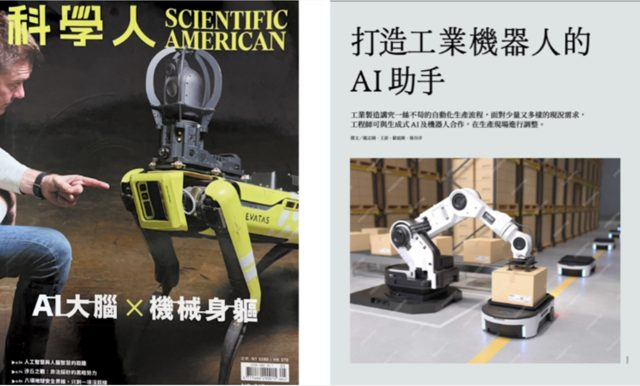
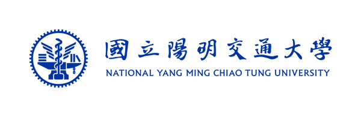

<!--
  元件說明（新增內容時照抄即可）：
  - 論文 / 文章：.feature（大卡片，左縮圖右文字）
  - 專案：.tile（兩欄磁磚，上縮圖下文字）
  - 學歷 / 經歷 / 教學：.tl-item，進行中的在日期後加 Current
  - 連結按鈕：<a class="pill"><i class="..."></i>文字</a>
    圖示：arXiv = fa-solid fa-file-lines、GitHub = fa-brands fa-github、
          網站 = fa-solid fa-globe、YouTube = fa-brands fa-youtube、文章 = fa-solid fa-newspaper
  - 直式影片在 media 容器加 media--contain，避免被裁切

  中英切換：
  - 要翻譯的文字寫兩份：English中文
  - 整段（例如自我介紹）就用兩個 
 / 
 包起來
  - 不需要翻譯的（論文標題、作者、期刊名）只寫一份、不加 lang，兩種語言都會顯示
  - News 的中文寫在 _data/news.yml 的 text_zh
  所有樣式都在 assets/css/style.scss
-->

<header class="hero">
  

    <!-- 照片在左；名字、簡介、按鈕、社群圖示在右，整塊與下方自介左緣對齊 -->
    

      
      

        <h1 class="hero-title">{{ site.title }}</h1>
        

          {{ site.description }}
          陽明交大機器人碩士生，研究機器人的定位與建圖。
        

        <!-- 按鈕與社群圖示排在同一行 -->
        

          

            <a class="btn btn-primary" href="{{ '/assets/doc/CV.pdf' | relative_url }}" target="_blank" rel="noopener noreferrer">View CV查看履歷</a>
            <a class="btn btn-secondary" href="mailto:kklb1716@gmail.com">Email me寄信給我</a>
          

          <ul class="hero-social">
            <li><a class="icon-btn" href="https://github.com/ouotingwei" target="_blank" rel="noopener noreferrer" aria-label="GitHub"><i class="fa-brands fa-github" aria-hidden="true"></i></a></li>
            <li><a class="icon-btn" href="https://www.linkedin.com/in/tingweiouo/" target="_blank" rel="noopener noreferrer" aria-label="LinkedIn"><i class="fa-brands fa-linkedin-in" aria-hidden="true"></i></a></li>
            <li><a class="icon-btn" href="https://www.youtube.com/@weiweiwei-2001" target="_blank" rel="noopener noreferrer" aria-label="YouTube"><i class="fa-brands fa-youtube" aria-hidden="true"></i></a></li>
          </ul>
        

      

    

  

</header>

<!-- ===== 自我介紹 ===== -->

  

    
Hi! I’m Wade, a Master’s student in Robotics at <a href="https://www.nycu.edu.tw/nycu/en/index">National Yang Ming Chiao Tung University (NYCU)</a>, advised by <a href="https://robotics.nycu.edu.tw/tw/teachers/show.php?num=14&amp;page=2">Prof. Kuu-Young Young</a> in the Human and Machine Lab. I received my B.S. in Mechanical Engineering from NYCU in 2023. I have also worked as a Research Intern with the Self-Driving Car Team at the <a href="https://www.itri.org.tw/english/index.aspx">ITRI</a> Mechanical and Mechatronics Systems Research Laboratories (MMSL), supervised by <a href="https://sites.google.com/site/chiehchihbobwang/home?authuser=0">Prof. Chieh-Chih Wang</a> and Dr. Victor Lu.

    
My research focuses on efficient and robust robot perception, particularly localization and mapping. I believe good research ideas often come from the corner cases that real-world deployment exposes, and that a system is only as useful as its ability to keep working when those cases occur.

    
I expect to graduate in February 2027 and am looking for PhD positions. Feel free to reach out!

  

  

    
嗨！我是 Wade，目前就讀<a href="https://www.nycu.edu.tw/">國立陽明交通大學（NYCU）</a>機器人碩士學位學程，在人機實驗室（Human and Machine Lab）由<a href="https://robotics.nycu.edu.tw/tw/teachers/show.php?num=14&amp;page=2">楊谷洋教授</a>指導。我於 2023 年取得陽明交大機械工程學系學士學位，也曾在<a href="https://www.itri.org.tw/">工研院</a>機械與機電系統研究所（MMSL）的自駕車團隊擔任研究實習生，由<a href="https://sites.google.com/site/chiehchihbobwang/home?authuser=0">王傑智教授</a>與 Victor Lu 博士指導。

    
我的研究聚焦於高效且穩健的機器人感知，特別是定位與建圖。我相信好的研究想法，往往來自實際部署時才會暴露出的極端情況；而一個系統真正的價值，在於這些情況發生時，它還能不能持續運作。

    
我預計於 2027 年 2 月畢業，目前正在尋找博士班機會，歡迎與我聯繫！

  

<!-- ===== News（內容來自 _data/news.yml） ===== -->
<section class="band band-gray" id="news">
  

    <h2 class="section-title">News最新消息</h2>
    <ol class="news">
      
      
        {{ item.text }}{{ item.text_zh }}
      
        
      
      <li class="news-item">
        {{ item.date }}
        <a href="{{ item.link }}" target="_blank" rel="noopener noreferrer">{{ news_text }}</a>{{ news_text }}
      </li>
      
    </ol>
  

</section>

<!-- ===== Research ===== -->
<section class="band" id="research">
  

    <h2 class="section-title">Research研究</h2>

    <h3 class="subsection-title">Publications論文發表</h3>

    <!-- Desc++ -->
    <article class="feature">
      

        <video src="assets/video/descpp.mp4" autoplay muted loop playsinline preload="metadata" aria-label="Desc++ demo"></video>
      

      

        <h4 class="feature-title">Desc++: Efficient Descriptor Enhancement for Data Association in Existing Visual SLAM Systems</h4>
        
Ting-Wei Ou, H.T. Lin, and Kuu-Young Young

        
IEEE Access, 2026

        

          <a class="pill" href="https://arxiv.org/abs/2607.11099" target="_blank" rel="noopener noreferrer"><i class="fa-solid fa-file-lines" aria-hidden="true"></i>arXiv</a>
          <a class="pill" href="https://github.com/ouotingwei/DescPP.git" target="_blank" rel="noopener noreferrer"><i class="fa-brands fa-github" aria-hidden="true"></i>GitHub</a>
          <a class="pill" href="https://ouotingwei.github.io/DescPP_website" target="_blank" rel="noopener noreferrer"><i class="fa-solid fa-globe" aria-hidden="true"></i>Demo展示網站</a>
        

      

    </article>

    <!-- SMC 2025 -->
    <article class="feature">
      

        <video src="assets/video/hotspot.mp4" autoplay muted loop playsinline preload="metadata" aria-label="Disinfection robot demo"></video>
      

      

        <h4 class="feature-title">Development of an Autonomous Mobile Robotic System for Efficient and Precise Disinfection</h4>
        
Ting-Wei Ou, J.H. Jiang, G.L. Huang, and Kuu-Young Young

        
IEEE International Conference on Systems, Man, and Cybernetics (SMC), Oct 2025, Vienna, Austria

        

          <a class="pill" href="https://arxiv.org/abs/2507.11270" target="_blank" rel="noopener noreferrer"><i class="fa-solid fa-file-lines" aria-hidden="true"></i>arXiv</a>
          <a class="pill" href="https://www.youtube.com/watch?v=wHcWzOcoMPM" target="_blank" rel="noopener noreferrer"><i class="fa-brands fa-youtube" aria-hidden="true"></i>Video影片</a>
        

      

    </article>

    <h3 class="subsection-title">Articles文章</h3>

    <!-- Scientific American -->
    <article class="feature">
      

        
      

      

        <h4 class="feature-title">Creating an AI Assistant for Industrial Robots</h4>
        
J.Y. Long, Yu Wang, Ting-Wei Ou, and Kuu-Young Young

        
Scientific American (Taiwan Edition), May 2024

        

          <a class="pill" href="https://www.scitw.cc/posts/AI-Robit" target="_blank" rel="noopener noreferrer"><i class="fa-solid fa-newspaper" aria-hidden="true"></i>Article閱讀文章</a>
        

      

    </article>
  

</section>

<!-- ===== Projects ===== -->
<section class="band band-gray" id="projects">
  

    <h2 class="section-title">Side projects其他專案</h2>

    

      <!-- ORB+FeatureBooster -->
      <article class="tile">
        

          <video src="assets/video/orb_fb.mp4" autoplay muted loop playsinline preload="metadata" aria-label="ORB-SLAM + FeatureBooster demo"></video>
        

        

          <h3 class="tile-title">ORB-SLAM + FeatureBooster</h3>
          

            This project integrates ORB-SLAM2 with FeatureBooster to enhance feature matching ability. We also implemented model quantization to reduce memory footprint for edge GPUs.
            本專案將 ORB-SLAM2 與 FeatureBooster 整合，以提升特徵匹配能力；我們也實作了模型量化，降低在邊緣 GPU 上的記憶體用量。
          

          

            <a class="pill" href="https://github.com/ouotingwei/ORB-SLAM2-FeatureBooster" target="_blank" rel="noopener noreferrer"><i class="fa-brands fa-github" aria-hidden="true"></i>GitHub</a>
            <a class="pill" href="https://www.youtube.com/watch?v=GHhYdiVRHz4" target="_blank" rel="noopener noreferrer"><i class="fa-brands fa-youtube" aria-hidden="true"></i>YouTube</a>
          

        

      </article>

      <!-- MAVIS -->
      <article class="tile">
        

          <video src="assets/video/mavis.mp4" autoplay muted loop playsinline preload="metadata" aria-label="Multi-camera ORB-SLAM3 demo"></video>
        

        

          <h3 class="tile-title">Extended Multi-camera ORB-SLAM3多相機擴充版 ORB-SLAM3</h3>
          

            Implementation of MAVIS-SLAM with ROS integration, enhancing robustness in challenging scenarios such as camera occlusion and severe illumination changes.
            實作 MAVIS-SLAM 並整合 ROS，提升系統在相機遮擋、劇烈光照變化等困難情境下的穩健性。
          

          

            <a class="pill" href="https://github.com/ouotingwei/mavis_ros.git" target="_blank" rel="noopener noreferrer"><i class="fa-brands fa-github" aria-hidden="true"></i>GitHub</a>
            <a class="pill" href="https://www.youtube.com/watch?v=Ie2tCVeXMDU" target="_blank" rel="noopener noreferrer"><i class="fa-brands fa-youtube" aria-hidden="true"></i>YouTube</a>
          

        

      </article>

      <!-- PPO -->
      <article class="tile">
        

          <video src="assets/video/ppo.mp4" autoplay muted loop playsinline preload="metadata" aria-label="RL racing car demo"></video>
        

        

          <h3 class="tile-title">Reinforcement Learning-based FPV Racing Car以強化學習控制的 FPV 賽車</h3>
          

            Implemented Proximal Policy Optimization (PPO) to learn an end-to-end control policy. The agent learns to navigate directly from raw image inputs.
            以近端策略最佳化（PPO）學習端到端的控制策略，讓代理人直接從原始影像輸入學會導航。
          

        

      </article>

      <!-- Undergraduate project -->
      <article class="tile">
        

          <video src="assets/video/undergraduate_rpoject.mp4" autoplay muted loop playsinline preload="metadata" aria-label="Visual SLAM in dynamic environments demo"></video>
        

        

          <h3 class="tile-title">Visual SLAM in Dynamic Environments動態環境中的視覺 SLAM</h3>
          

            I mentored undergraduate students (2025) on a project to improve the robustness of Visual SLAM in dynamic scenes. We integrated YOLOv8 semantic segmentation into ORB-SLAM2 to detect and remove feature points on moving objects, particularly humans, thereby reducing their adverse impact on front-end camera pose estimation.
            我在 2025 年指導大學部學生進行這個專案，目標是提升視覺 SLAM 在動態場景中的穩健性。我們將 YOLOv8 語意分割整合進 ORB-SLAM2，偵測並移除移動物體（特別是行人）上的特徵點，降低它們對前端相機位姿估測的負面影響。
          

        

      </article>

      <!-- HL Project -->
      <article class="tile">
        

          <video src="assets/video/hl.mp4" autoplay muted loop playsinline preload="metadata" aria-label="Plasma spraying system demo"></video>
        

        

          <h3 class="tile-title">Development of an Autonomous Plasma Spraying System自動化電漿噴塗系統開發</h3>
          

            This project was developed during my time as a System Development Engineer at Hong Lang Technology Co., Ltd. The goal was to build an automated plasma-spraying system. The work involved surface reconstruction, robotic arm path planning, and user I/O interface and visualization.
            這是我在 Hong Lang Technology Co., Ltd. 擔任系統開發工程師期間的專案，目標是打造一套自動化電漿噴塗系統。工作內容包含曲面重建、機械手臂路徑規劃，以及使用者 I/O 介面與視覺化。
          

          <!-- 

            <a class="pill" href="https://www.youtube.com/watch?v=sccCDnw98aE" target="_blank" rel="noopener noreferrer"><i class="fa-brands fa-youtube" aria-hidden="true"></i>YouTube</a>
          
 -->
        

      </article>

      <!-- iTron -->
      <article class="tile">
        

          <video src="assets/video/itron.mp4" autoplay muted loop playsinline preload="metadata" aria-label="TDK Robocon robot demo"></video>
        

        

          <h3 class="tile-title">Development of a Mobile Robot Platform for TDK RoboconTDK 盃機器人競賽移動平台開發</h3>
          

            During my time with the NYCU iTron Robotics Team, our group developed a robot capable of autonomous navigation, basketball shooting, and bowling. I was responsible for LiDAR localization and chassis control.
            在陽明交大 iTron 機器人隊期間，我們團隊開發了一台能自主導航、投籃與打保齡球的機器人，我負責光達定位與底盤控制。
          

          

            <a class="pill" href="https://github.com/ouotingwei/autonomous-basketball-and-bowling-vehicle.git" target="_blank" rel="noopener noreferrer"><i class="fa-brands fa-github" aria-hidden="true"></i>GitHub</a>
            <a class="pill" href="https://www.youtube.com/watch?v=ZmdiB1q2GPI" target="_blank" rel="noopener noreferrer"><i class="fa-brands fa-youtube" aria-hidden="true"></i>YouTube</a>
          

        

      </article>
    

  

</section>

<!-- ===== Experience ===== -->
<section class="band" id="experience">
  

    <h2 class="section-title">Experience經歷</h2>

    <h3 class="subsection-title">Education學歷</h3>
    

      

        2023 – Present至今 Current目前
        

          National Yang Ming Chiao Tung University (NYCU)國立陽明交通大學（NYCU）
          Graduate Degree Program of Robotics機器人碩士學位學程
          formerly National Chiao Tung University (NCTU)前身為國立交通大學（NCTU）
        

        
      

      

        2019 – 2023
        

          National Yang Ming Chiao Tung University (NYCU)國立陽明交通大學（NYCU）
          Bachelor of Science in Mechanical Engineering機械工程學系 學士
          formerly National Chiao Tung University (NCTU)前身為國立交通大學（NCTU）
        

        
      

    

    <h3 class="subsection-title">Industry experience &amp; services業界經歷與服務</h3>
    

      

        2026 – Present至今 Current目前
        

          Industrial Technology Research Institute (ITRI) – MMSL工業技術研究院（ITRI）機械與機電系統研究所
          Intern實習生
          Integrating learning-based point cloud registration into a production HD mapping pipeline to improve robustness over classical scan matching in challenging environments.將基於學習的點雲對位方法整合進實際運作中的高精地圖建置流程，在困難環境中取得比傳統掃描匹配更好的穩健性。
        

      

      

        2023 – 2024
        

          Hong Lang Technology Co., Ltd.
          Automation System Development Engineer自動化系統開發工程師
          Developed automated machinery systems to modernize traditional footwear manufacturing processes for industrial-scale production.開發自動化機械系統，推動傳統製鞋流程現代化，以達到工業規模的量產。
        

      

      

        2020 – 2021
        

          NYCU iTron Robotics Team陽明交大 iTron 機器人隊
          Team Leader隊長
          Led the design, software-hardware integration, and competition deployment of customized robotic platforms.帶領客製化機器人平台的設計、軟硬體整合與競賽部署。
        

      

    

    <h3 class="subsection-title">Teaching experience教學經歷</h3>
    

      

        Spring 20252025 春季
        

          NYCU陽明交大
          Teaching Assistant, 535311: Robotics助教，535311：機器人學
        

      

    

    <!-- Honors and Scholarships（已改成新版樣式，要顯示時把註解拿掉即可）
    <h3 class="subsection-title">Honors and scholarships榮譽與獎學金</h3>
    

      

        2026
        

          NYCU陽明交大
          Graduate Research Scholarship (NYCU Robotics)研究生研究獎學金（陽明交大機器人學程）
        

      

      

        2025
        

          NYCU陽明交大
          NSTC Graduate Student International Conference Travel Grant國科會補助研究生出席國際學術會議
        

      

      

        2025
        

          NYCU陽明交大
          Graduate Research Scholarship (NYCU Robotics)研究生研究獎學金（陽明交大機器人學程）
        

      

      

        2024
        

          NYCU陽明交大
          Graduate Research Scholarship (NYCU Robotics)研究生研究獎學金（陽明交大機器人學程）
        

      

      

        2023
        

          NYCU陽明交大
          Master's Program Entrance Scholarship (First place)碩士班入學獎學金（第一名）
        

      

      

        2021
        

          NYCU陽明交大
          26th TDK Robocon: Honorable Mention (Autonomous Robotics)第 26 屆 TDK 盃機器人競賽 自動組佳作
        

      

    

    -->
  

</section>

<!-- ===== More：Daily papers + 台灣時間 + 足跡地圖 ===== -->
<section class="band band-gray" id="more">
  

    <h2 class="section-title">More更多</h2>
    

      <!-- 左欄：Daily arXiv + 台灣時間（包成一欄，右邊地圖不受影響） -->
      

        

          <i class="fa-solid fa-newspaper" aria-hidden="true"></i>
          <h3 class="card-title">Daily arXiv Digest每日 arXiv 論文摘要</h3>
          

            New robotics, SLAM and computer vision papers on arXiv, summarized every day.
            每天整理 arXiv 上最新的機器人、SLAM 與電腦視覺論文摘要。
          

          <a class="btn btn-secondary btn-sm" href="https://ouotingwei.github.io/daily-arXiv-ai-enhanced/" target="_blank" rel="noopener noreferrer">Open the digest開啟摘要</a>
        

        <!-- 台灣時間時鐘：狀態文字可在頁尾 script 的 statusFor() 修改 -->
        

          <i class="fa-solid fa-clock" aria-hidden="true"></i>
          <h3 class="card-title">My local time我的當地時間</h3>
          
--:--:--

          
Hsinchu, Taiwan · UTC+8

          
&nbsp;

          
&nbsp;

        

      

      

        

          <h3 class="card-title">Footprints足跡</h3>
          

            Conferences, my lab, and places I've traveled. Hover or tap a dot to see a photo.
            參加過的會議、我的實驗室，以及旅行去過的地方。把滑鼠移到圓點上（或點一下）就能看到照片。
          

        

        

      

    

  

</section>

<!-- ===== 台灣時間時鐘 script ===== -->
